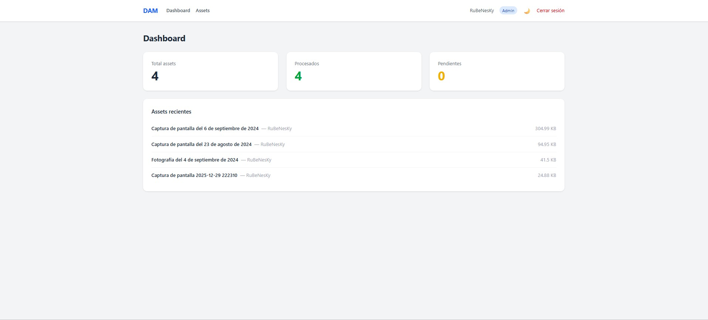
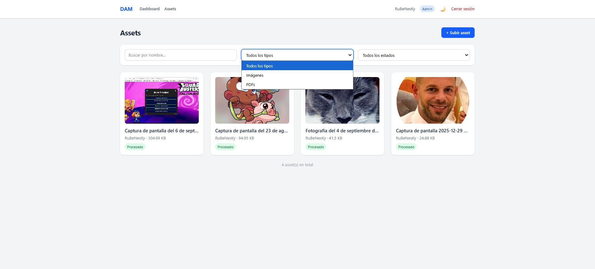
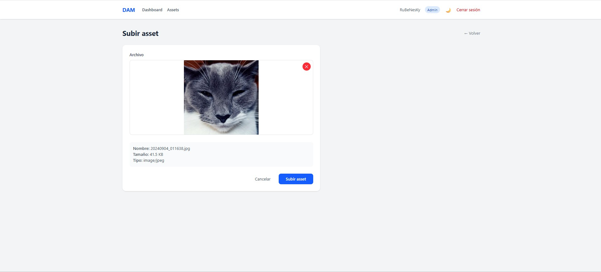
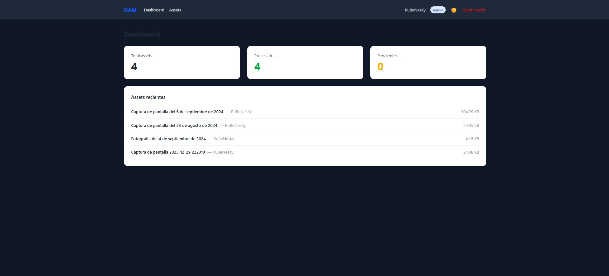

# DAM Frontend — Digital Asset Management


Frontend SPA desarrollado con Vue 3 que consume la API REST del proyecto [DAM Platform](https://github.com/Rubenesky/dam-platform).

## 🌐 Demo en producción

**Frontend:** https://dam-platform-ai.netlify.app

**Backend API:** https://dam-platform.onrender.com

> ⚠️ El servidor backend puede tardar 30-50 segundos en arrancar la primera vez por ser el plan gratuito de Render.

## 🚀 Características

- **Vue 3** con Composition API
- **Vue Router** con protección de rutas por autenticación
- **Pinia** para gestión de estado global (autenticación y tema)
- **Tailwind CSS** para estilos
- **Axios** con interceptores para manejo global de errores
- **CRUD completo** — ver, subir, editar y borrar assets
- **🧠 Búsqueda inteligente con IA** — escribe en lenguaje natural y Gemini filtra automáticamente
- **Filtros en tiempo real** sin recargar la página
- **Paginación** consumiendo la API
- **Subida de archivos** con drag & drop y vista previa
- **Toast notifications** para feedback al usuario
- **Página 404** personalizada
- **Responsive** con menú hamburguesa para móvil
- **Modo oscuro** con persistencia en localStorage
- **Metadatos generados por IA** visibles en la interfaz con badge ✨
- **Aviso de duplicados** cuando la IA detecta assets similares
- **🧠 Generador de variantes con IA** — sugerencias de títulos, descripciones y tags aplicables con un clic
- **🔒 Detección de duplicados exactos** — bloquea la subida del mismo archivo via hash MD5
- **🤖 RAG — Chat con la base de datos** — pregunta en lenguaje natural sobre tus assets y la IA responde con datos reales

## 🛠️ Stack tecnológico

| Capa          | Tecnología   |
| ------------- | ------------ |
| Framework     | Vue 3        |
| Routing       | Vue Router   |
| Estado global | Pinia        |
| HTTP Client   | Axios        |
| Estilos       | Tailwind CSS |
| Build tool    | Vite         |
| Tests         | Vitest       |
| CI/CD         | GitHub Actions |

## ⚙️ Instalación local

### Requisitos previos

- Node.js 18+
- npm
- [DAM Platform](https://github.com/Rubenesky/dam-platform) corriendo en local

### Pasos

```bash
# 1. Clonar el repositorio
git clone https://github.com/Rubenesky/dam-frontend.git
cd dam-frontend

# 2. Instalar dependencias
npm install

# 3. Configurar variables de entorno
cp .env.example .env
# Editar .env y ajustar VITE_API_URL si es necesario

# 4. Arrancar el servidor de desarrollo
npm run dev
```

Entra a `http://localhost:5173` en el navegador.

## 🔗 Conexión con el backend

Este proyecto consume la API REST de [DAM Platform](https://github.com/Rubenesky/dam-platform). Asegúrate de que el backend está corriendo en `http://localhost:8000` antes de arrancar el frontend.

La configuración de la URL base de la API está en `src/api/axios.js`:

```javascript
// En src/api/axios.js
const api = axios.create({
  baseURL: import.meta.env.VITE_API_URL,
})
```

> La URL de la API se configura mediante la variable de entorno `VITE_API_URL`. Copia `.env.example` a `.env` y ajusta el valor según tu entorno (local o producción).

## 📱 Vistas disponibles

| Ruta             | Vista                                 | Acceso      |
| ---------------- | ------------------------------------- | ----------- |
| `/login`         | Formulario de login                   | Público     |
| `/dashboard`     | Estadísticas y assets recientes       | Autenticado |
| `/assets`        | Listado con filtros y paginación      | Autenticado |
| `/assets/:id`    | Detalle de asset con metadatos IA     | Autenticado |
| `/assets/upload` | Subida con drag & drop y vista previa | Autenticado |
| `/*`             | Página 404 personalizada              | Público     |

## 🔐 Autenticación

El frontend usa autenticación por token con Laravel Sanctum. Al hacer login se guarda el token en `localStorage` y se añade automáticamente a todas las peticiones via un interceptor de Axios.

Si el token expira o es inválido, el usuario es redirigido automáticamente al login con un mensaje de error.

## 🌙 Modo oscuro

La preferencia de tema se guarda en `localStorage` y persiste entre sesiones. El botón de cambio de tema está disponible en el navbar tanto en escritorio como en móvil.

## ⚠️ Manejo de errores

Los errores de la API se gestionan globalmente mediante interceptores de Axios:

- **Sin conexión** — aviso de servidor no disponible
- **401** — redirección automática al login
- **403** — aviso de permisos insuficientes
- **404** — aviso de recurso no encontrado
- **422** — muestra el primer error de validación
- **500+** — aviso de error en el servidor

## 📸 Capturas de pantalla

### Dashboard



### Listado de assets



### Subida con vista previa



### Modo oscuro



## 🧪 Tests

9 tests automatizados con CI/CD en GitHub Actions.

```bash
# Ejecutar todos los tests
npm run test
```

Los tests cubren:
- Auth store: login guarda token, logout limpia estado, isAuthenticated
- Validación de archivos: tipos no permitidos, archivos >10MB, archivos válidos
- Router guards: redirección sin token, acceso con token, guest con token

## 👨‍💻 Autor

Desarrollado por **Rubén Jiménez** como proyecto de portfolio para el módulo DAW.

Proyecto backend: [DAM Platform](https://github.com/Rubenesky/dam-platform)
